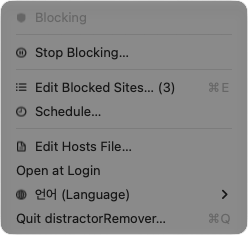
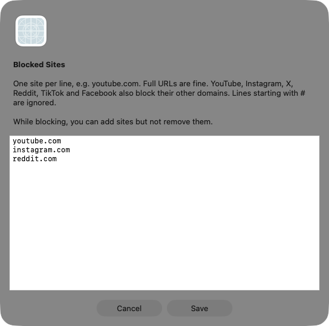
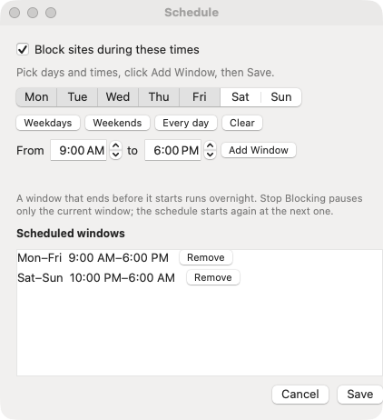
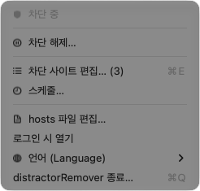
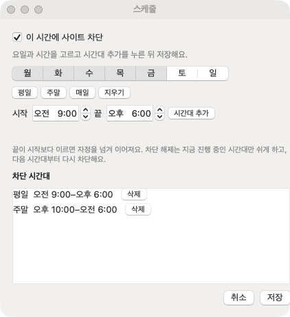

# distractorRemover

[](https://github.com/ksemperor97/distractorRemover/actions/workflows/ci.yml)

**English** · [한국어](#한국어)

A small macOS menu bar app that blocks distracting websites, by hand or on a schedule, using the hosts file.

---

## English

| Menu | Blocked sites | Schedule |
|---|---|---|
|  |  |  |

### Features

- **Edit Blocked Sites…**: a plain text list, one site per line. Full URLs are fine. YouTube, Instagram, X, Reddit, TikTok and Facebook also block their other domains (e.g. `m.youtube.com`, `youtu.be`).
- **Start Blocking / Stop Blocking…**: there are two kinds of blocking, by hand and by schedule. Stop Blocking turns off both: it pauses the current schedule window until it ends, and the schedule blocks again at its next window (for example, the next morning).
- **Schedule…**: days and times, including overnight windows such as 10:00 PM–6:00 AM.
- **Edit Hosts File…**: for when something looks wrong, edit the whole hosts file as text. A backup is saved first.
- While blocking, sites can be added but not removed.
- Korean and English; switch in **언어 (Language)** without restarting.
- Leaves the rest of your hosts file alone. If the distractorRemover marker lines are damaged (missing, reversed or nested), the app doesn't touch the file and asks you to fix it in the hosts editor.

### Install (Release)

There is no release yet. Build from source below.

### Requirements

- macOS 13 or later
- Xcode Command Line Tools (`xcode-select --install`) to build. Full Xcode is not needed.

### Build from source

```bash
git clone https://github.com/ksemperor97/distractorRemover.git
cd distractorRemover
./build_app.sh --install      # builds, copies to /Applications, launches
```

`./build_app.sh` alone builds `dist/distractorRemover.app`. Turn on **Open at Login** so the schedule keeps working after a restart.

To remove everything (app, login item, hosts section, helper), run `./uninstall.sh`. Add `--remove-config` to also delete saved sites and schedules, or `--dry-run` to see what would be removed.

### How it works

- Blocking adds `127.0.0.1` and `::1` lines for each domain between two marker lines in `/etc/hosts`.
- The first time you turn on a schedule, you are asked for your password once. This installs a small helper (`/usr/local/bin/distractorremover-helper` plus a sudoers rule for that file only) so the app can switch blocking on and off by itself. The helper only rewrites the app's own section and refuses damaged markers. Without it, each change asks for your password.
- The app checks the time every 5 seconds, right after waking from sleep, and when the clock or time zone changes. It re-checks the hosts file every 30 seconds and retries failed updates (5 s, 15 s, then every 30 s). Click the status line to retry at once.
- Quitting leaves the hosts file as it is and stops schedule changes until the app is opened again; the app tells you before it quits.
- A damaged settings file is kept as `config.json.corrupt-<date>`, and the app starts with empty settings.
- Files: `~/Library/Application Support/distractorRemover/` (`config.json`, `app.log`, `hosts-backups/`).

Limits: hosts files can't block every subdomain or direct IP access, and browsers may keep an open connection for a moment. It adds friction for everyday impulses; an administrator can always undo it.

### Development

Changes are checked by running the app. `./build_app.sh` builds the release `.app` with an ad-hoc signature, and `./build_app.sh --zip` also makes `dist/distractorRemover-<version>.zip` for a release.

Sandbox mode runs the app against a scratch hosts file without touching `/etc/hosts` or the installed app's settings:

```bash
DISTRACTORREMOVER_SANDBOX=/tmp/dr-sandbox dist/distractorRemover.app/Contents/MacOS/distractorRemover
```

`DISTRACTORREMOVER_DEBUG_SHOW=menu|menu-dump|schedule-editor|sites|hosts|quit` opens that screen at launch (`menu-dump` prints the menu as text and quits). `DISTRACTORREMOVER_SANDBOX_PROMPT=cancel` simulates cancelling the password prompt.

Layout: `Sources/BlockerCore` (logic, storage, helper backend; no AppKit), `Sources/AppText` (Korean/English wording), `Sources/DistractorRemover` (menu bar UI), `helper/` (privileged shell scripts).

---

## 한국어

방해되는 웹사이트를 직접 또는 스케줄에 따라 차단하는 작은 macOS 메뉴바 앱이에요. hosts 파일을 사용해요.

| 메뉴 | 차단 사이트 | 스케줄 |
|---|---|---|
|  |  |  |

### 기능

- **차단 사이트 편집…** 한 줄에 사이트 하나씩 적는 텍스트 목록이에요. 전체 URL도 괜찮아요. YouTube, Instagram, X, Reddit, TikTok, Facebook은 다른 도메인(예: `m.youtube.com`, `youtu.be`)까지 함께 차단해요.
- **차단 시작 / 차단 해제…** 차단은 직접 켜는 것과 스케줄 두 가지예요. 차단 해제는 둘 다 꺼요. 지금 진행 중인 스케줄 시간대는 끝날 때까지 쉬고, 다음 시간대(예: 다음 날 아침)부터 다시 차단해요.
- **스케줄…** 요일과 시간을 정해요. 오후 10:00–오전 6:00처럼 자정을 넘는 시간대도 돼요.
- **hosts 파일 편집…** 뭔가 이상할 때 hosts 파일 전체를 텍스트로 고쳐요. 먼저 백업을 저장해요.
- 차단 중에는 사이트를 추가할 수만 있고 지울 수는 없어요.
- 한국어와 영어를 지원하고, **언어 (Language)** 메뉴에서 다시 시작하지 않고 바꿀 수 있어요.
- hosts 파일의 다른 내용은 건드리지 않아요. distractorRemover 표시 줄이 손상되면(빠짐, 순서 뒤바뀜, 겹침) 파일을 건드리지 않고 hosts 편집기에서 고치도록 안내해요.

### 설치 (Release)

아직 릴리스가 없어요. 아래처럼 소스에서 빌드해 주세요.

### 요구 사항

- macOS 13 이상
- 빌드에는 Xcode Command Line Tools(`xcode-select --install`)가 필요해요. Xcode 전체는 필요 없어요.

### 소스에서 빌드

```bash
git clone https://github.com/ksemperor97/distractorRemover.git
cd distractorRemover
./build_app.sh --install      # 빌드하고 /Applications에 복사한 뒤 실행
```

`./build_app.sh`만 실행하면 `dist/distractorRemover.app`을 만들어요. 재시동 후에도 스케줄이 동작하도록 **로그인 시 열기**를 켜 두세요.

앱, 로그인 항목, hosts 구간, helper를 모두 지우려면 `./uninstall.sh`를 실행해요. 저장한 사이트와 스케줄까지 지우려면 `--remove-config`를, 지울 대상만 보려면 `--dry-run`을 붙여요.

### 동작 방식

- 차단하면 `/etc/hosts`의 두 표시 줄 사이에 도메인마다 `127.0.0.1`과 `::1` 줄을 넣어요.
- 스케줄을 처음 켤 때 암호를 한 번 물어요. 앱이 스스로 차단을 켜고 끌 수 있도록 작은 helper(`/usr/local/bin/distractorremover-helper`와 그 파일만 허용하는 sudoers 규칙)를 설치하기 때문이에요. helper는 앱 자신의 구간만 다시 쓰고, 표시 줄이 손상되면 거부해요. helper가 없으면 바꿀 때마다 암호를 물어요.
- 앱은 5초마다, 잠자기에서 깨어났을 때, 시계나 시간대가 바뀌었을 때 시각을 확인해요. 30초마다 hosts 파일을 다시 확인하고, 실패하면 5초, 15초, 이후 30초마다 다시 시도해요. 상태 줄을 누르면 바로 다시 시도해요.
- 종료해도 hosts 파일은 그대로이고, 앱을 다시 열 때까지 스케줄 전환이 멈춰요. 종료하기 전에 앱이 알려 줘요.
- 설정 파일이 손상되면 `config.json.corrupt-<날짜>`로 보관하고 빈 설정으로 시작해요.
- 파일 위치: `~/Library/Application Support/distractorRemover/` (`config.json`, `app.log`, `hosts-backups/`)

한계: hosts 파일로는 모든 하위 도메인이나 IP 직접 접속을 막을 수 없고, 브라우저가 열린 연결을 잠시 유지할 수 있어요. 일상적인 충동에 마찰을 더하는 도구이고, 관리자는 언제든 되돌릴 수 있어요.

### 개발

변경 사항은 앱을 직접 실행해서 확인해요. `./build_app.sh`는 ad-hoc 서명된 릴리스 `.app`을 만들고, `./build_app.sh --zip`은 릴리스용 `dist/distractorRemover-<버전>.zip`도 만들어요.

샌드박스 모드는 `/etc/hosts`나 설치된 앱의 설정을 건드리지 않고 임시 hosts 파일로 앱을 실행해요.

```bash
DISTRACTORREMOVER_SANDBOX=/tmp/dr-sandbox dist/distractorRemover.app/Contents/MacOS/distractorRemover
```

`DISTRACTORREMOVER_DEBUG_SHOW=menu|menu-dump|schedule-editor|sites|hosts|quit`은 실행 직후 해당 화면을 열어요(`menu-dump`는 메뉴를 텍스트로 출력하고 종료). `DISTRACTORREMOVER_SANDBOX_PROMPT=cancel`은 암호 입력 취소를 흉내 내요.

구성: `Sources/BlockerCore`(로직, 저장, helper 연동, AppKit 없음), `Sources/AppText`(한국어/영어 문구), `Sources/DistractorRemover`(메뉴바 UI), `helper/`(권한 셸 스크립트)
